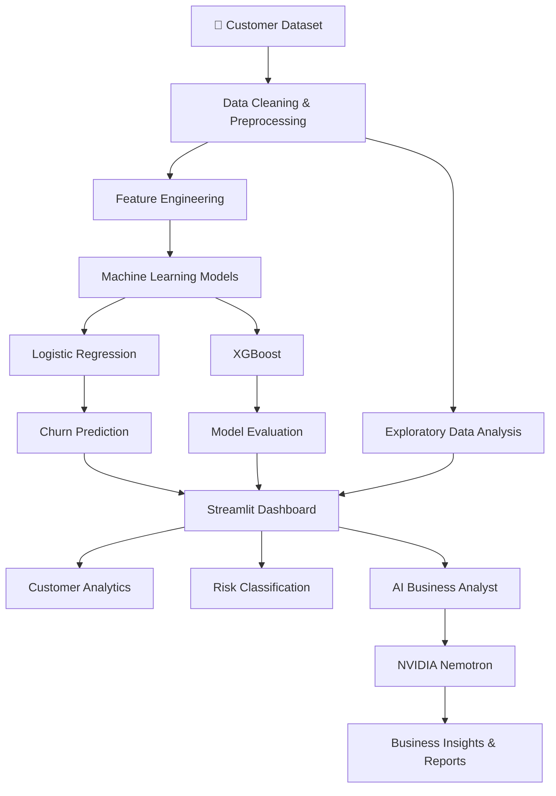

<div align="center">

# ⚡ CHURNIQ
[](https://churniqai18.streamlit.app)

### INTELLIGENT CUSTOMER CHURN ANALYTICS

**Predict churn. Understand behavior. Protect revenue.**

An AI-powered customer analytics platform combining Machine Learning, interactive visualizations, and generative AI to turn customer data into actionable business intelligence.

<br>


<br>

[**Explore Repository**](https://github.com/saqib-ai18/customer-churn-prediction)
&nbsp; • &nbsp;
[**Report an Issue**](https://github.com/saqib-ai18/customer-churn-prediction/issues)

</div>

---

## ◈ THE PROBLEM

Customer churn is one of the biggest challenges businesses face.

Losing customers means losing recurring revenue, increasing acquisition costs, and weakening long-term customer relationships.

But what if businesses could identify customers at risk of leaving before they actually do?

**CHURNIQ is built to solve that problem.**

It analyzes customer behavior, predicts churn probability, identifies high-risk customers, and generates AI-powered business recommendations.

---

## ◈ PRODUCT OVERVIEW

CHURNIQ brings six analytical capabilities into one interactive platform.

| Module | What it does |
|:---|:---|
| 📊 Overview | Customer statistics, retention KPIs, and business snapshots |
| 📈 Churn Analytics | Explore churn patterns across customer segments |
| 👤 Customer Explorer | Search, filter, and inspect individual customers |
| 🎯 Churn Prediction | Predict churn probability and customer risk levels |
| 🧪 Model Performance | Compare Logistic Regression and XGBoost |
| 🧠 AI Business Analyst | Generate AI-powered churn reports and recommendations |

---

## ◈ THE NUMBERS

<div align="center">

| 👥 CUSTOMERS | 📉 CHURNED | 🟢 RETAINED | ⚠️ CHURN RATE |
|:---:|:---:|:---:|:---:|
| **7,043** | **1,869** | **5,174** | **26.54%** |

</div>

These figures are based on the IBM Telco Customer Churn dataset.

---

## ◈ MACHINE LEARNING ENGINE

Two classification algorithms were developed and evaluated.

### Model Benchmark

| Evaluation Metric | Logistic Regression | XGBoost |
|:---|---:|---:|
| Accuracy | **80.55%** | 79.56% |
| Precision | **65.72%** | 64.24% |
| Recall | **55.88%** | 51.87% |
| F1-Score | **60.40%** | 57.40% |
| ROC-AUC | **84.21%** | 84.08% |

### Selected Model: Logistic Regression

Logistic Regression achieved slightly better performance on the current evaluation split.

The prediction pipeline includes:

- Numerical feature scaling.
- Categorical feature encoding.
- ColumnTransformer preprocessing.
- Logistic Regression classification.
- Probability-based churn prediction.
- Adjustable classification threshold.

**Prediction threshold: 0.30**

The lower threshold prioritizes identifying more potential churners, at the cost of potentially generating more false positives.

---

## ◈ AI BUSINESS ANALYST

### From raw customer data to business intelligence.

CHURNIQ integrates **NVIDIA Nemotron** through an API to generate AI-powered customer churn analysis.

The AI Business Analyst can:

- Analyze customer churn patterns.
- Summarize important business observations.
- Highlight potential retention concerns.
- Generate actionable recommendations.
- Produce downloadable analytical reports.

**Technology:** NVIDIA Nemotron API + OpenAI Python SDK.

The AI analysis complements the machine learning model; it does not replace the model's predictions.

---

## ◈ SYSTEM ARCHITECTURE



---

## ◈ TECHNOLOGY STACK

<div align="center">

| Layer | Technologies |
|:---|:---|
| Language | Python |
| Data Processing | Pandas, NumPy |
| Visualization | Plotly, Matplotlib, Seaborn |
| Machine Learning | Scikit-learn, XGBoost |
| Application | Streamlit |
| Generative AI | NVIDIA Nemotron |
| API Integration | OpenAI SDK |
| Model Storage | Joblib |
| Environment | Python Virtual Environment, python-dotenv |
| Version Control | Git, GitHub |

</div>

---

## ◈ PROJECT STRUCTURE

```text
customer-churn-prediction/
│
├── app.py
│
├── data/
│   ├── raw/
│   │   └── customer_churn.csv
│   │
│   └── processed/
│       └── customer_churn_clean.csv
│
├── models/
│   ├── logistic_regression.pkl
│   └── xgboost_model.pkl
│
├── reports/
│   └── figures/
│
├── src/
│   ├── explore_data.py
│   ├── eda.py
│   ├── visualize.py
│   ├── preprocess.py
│   ├── train_model.py
│   ├── train_xgboost.py
│   ├── threshold_tuning.py
│   ├── predict.py
│   └── ai_analyst.py
│
├── .gitignore
├── requirements.txt
└── README.md
```

---

## ◈ GET STARTED

Want to run CHURNIQ locally? Follow these steps.

### 01 — Clone the repository

```bash
git clone https://github.com/saqib-ai18/customer-churn-prediction.git
```

### 02 — Navigate into the project

```bash
cd customer-churn-prediction
```

### 03 — Create a virtual environment

```bash
python -m venv .venv
```

### 04 — Activate the environment

**Windows PowerShell**

```powershell
.venv\Scripts\Activate.ps1
```

### 05 — Install dependencies

```bash
pip install -r requirements.txt
```

### 06 — Configure NVIDIA API

Create a `.env` file in the project root:

```env
NVIDIA_API_KEY=your_nvidia_api_key
```

The API key is required for the AI Business Analyst feature.

**Important:** Never upload your `.env` file or expose your API key.

### 07 — Launch CHURNIQ

```bash
streamlit run app.py
```

Your local application will open in your browser.

---

## ◈ DATASET

**IBM Telco Customer Churn Dataset**

The dataset contains customer information, subscription details, billing information, and churn labels.

| Attribute | Value |
|:---|---:|
| Total Records | 7,043 |
| Total Features | 21 |
| Churned Customers | 1,869 |
| Retained Customers | 5,174 |
| Churn Rate | 26.54% |

The dataset was cleaned and prepared before model training.

---

## ◈ WHAT I LEARNED

Building CHURNIQ involved working across the complete machine learning workflow:

- Data cleaning and preprocessing.
- Exploratory Data Analysis.
- Feature transformation and encoding.
- Training classification algorithms.
- Evaluating model performance.
- Classification threshold optimization.
- Integrating a generative AI API.
- Building an interactive Streamlit application.
- Managing project versions using Git and GitHub.

---

## ◈ FUTURE IMPROVEMENTS

- [ ] Deploy a live public dashboard.
- [ ] Add SHAP-based model explainability.
- [ ] Implement customer retention recommendations.
- [ ] Add customer segmentation.
- [ ] Introduce automated model retraining.
- [ ] Add model monitoring and drift detection.

---

## ◈ DEVELOPER

<div align="center">

### Mohammed Saqib

**AI & Machine Learning Engineer | Data Analytics Enthusiast**

Building practical applications at the intersection of Machine Learning, Data Analytics, and Generative AI.

<br>

[](https://github.com/saqib-ai18)
[](https://linkedin.com/in/saqib-kolkar-3222a6379)

<br>

**If you find CHURNIQ interesting, consider giving the repository a ⭐**

<br>

*Turning customer data into smarter decisions.*

</div>